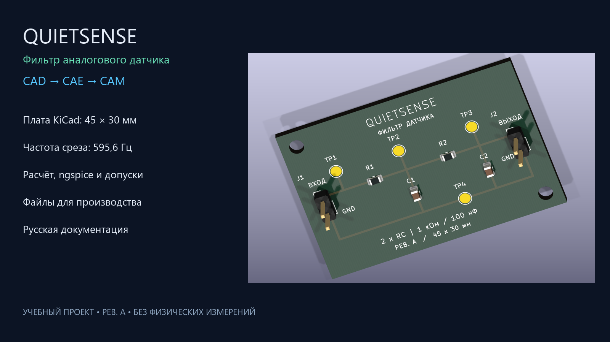
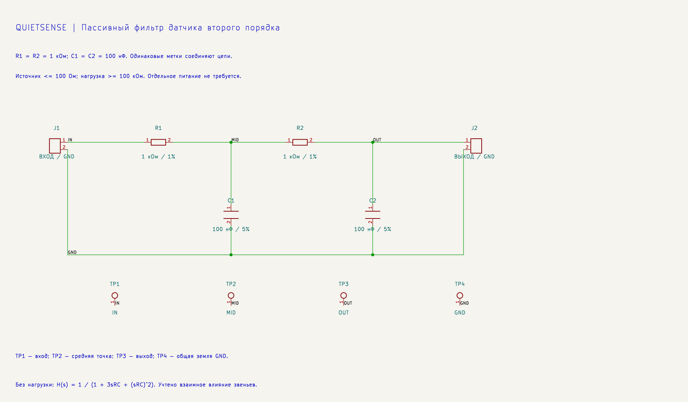
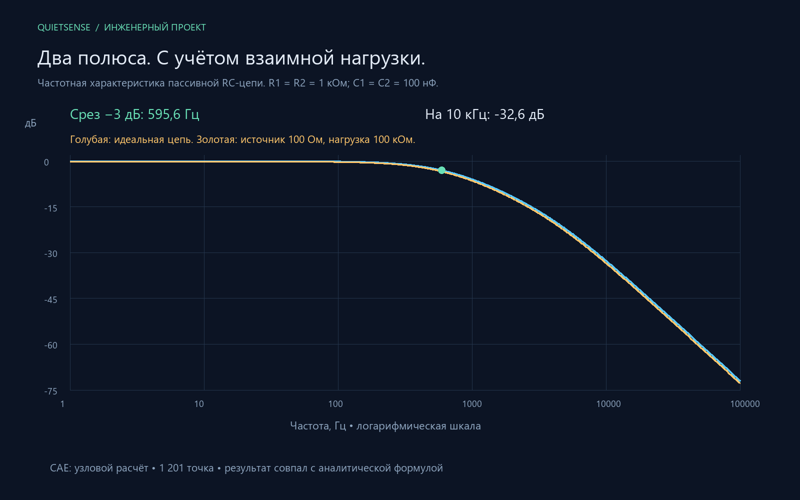
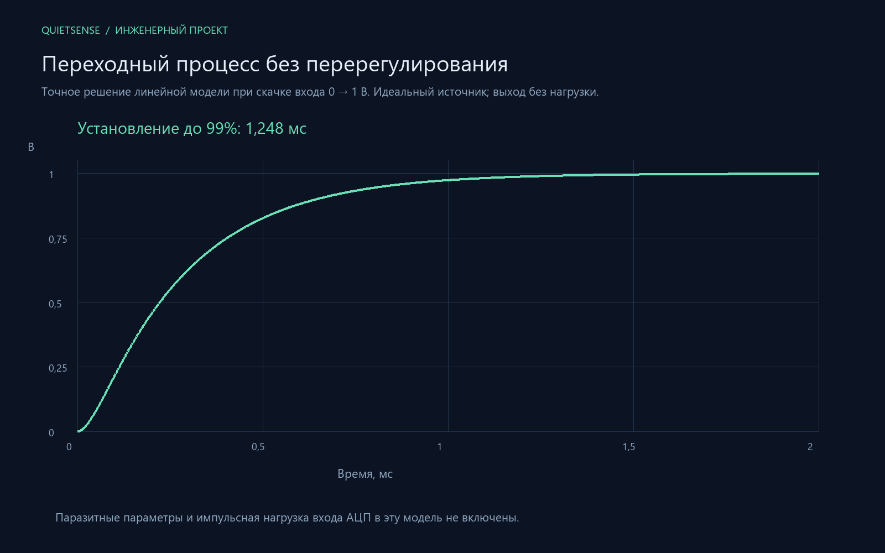
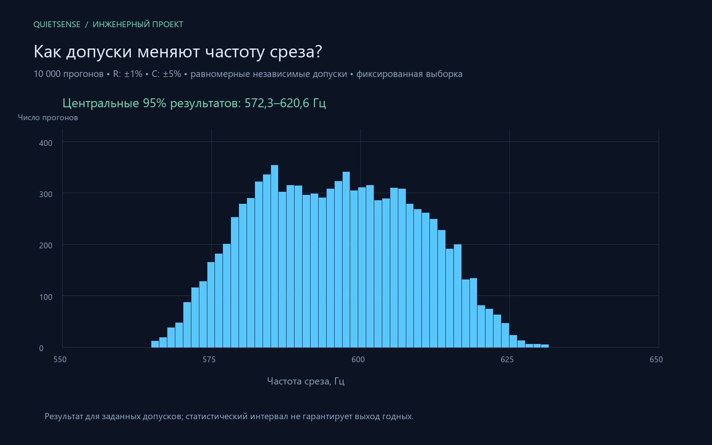
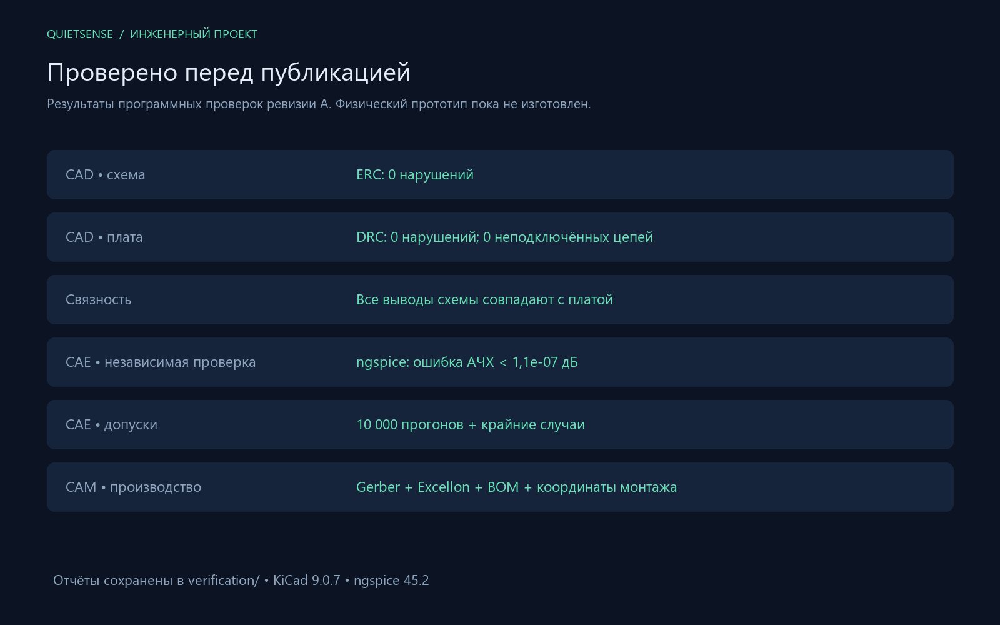
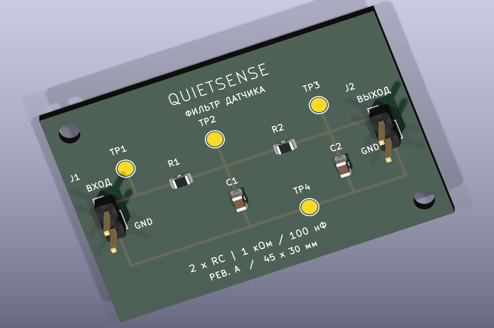
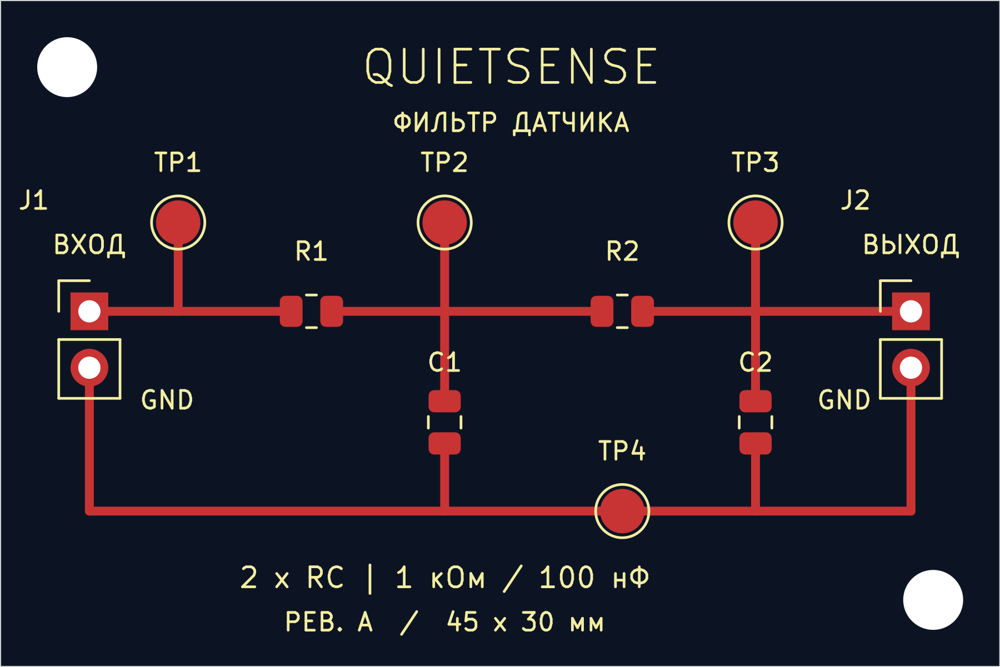

# QuietSense

**Небольшая плата, полный инженерный цикл: CAD → CAE → CAM.**

Двухзвенный пассивный RC-фильтр для медленно меняющихся аналоговых сигналов: датчиков температуры, положения, потенциометров. Без микроконтроллера, прошивки и отдельного питания. Цель проекта — показать не сложность схемы, а связь требований, расчёта, разводки и подготовки производства.



> Статус: учебный проект Rev A. Изготовление и измерения на реальной плате не выполнялись. Графики ниже — результаты модели, а не осциллограммы. Производственные файлы не означают подтверждённую работоспособность изделия.

## Что здесь CAD, CAE и CAM

| Этап | Результат | Где смотреть |
|---|---|---|
| CAD | Редактируемая схема и разведённая плата KiCad, 45 × 30 мм | [`hardware/`](hardware/) |
| CAE | Узловой AC-анализ, переходный процесс, влияние нагрузки, допуски | [`simulation/results/summary.json`](simulation/results/summary.json) |
| CAM | Gerber, Excellon, BOM и координаты установки | [`manufacturing/`](manufacturing/) |
| Проверка | Отчёты ERC/DRC и проверка соответствия соединений | [`verification/`](verification/) |

## Схема и требования



```text
J1.1 IN ── R1 1k ──┬── R2 1k ──┬── OUT J2.1
                    C1 100n      C2 100n
                    │           │
J1.2 GND ───────────┴───────────┴── GND J2.2
```

TP1 — вход, TP2 — средняя точка, TP3 — выход, TP4 — земля. Резисторы 0805, 1%; конденсаторы 0805, 100 нФ, 5%, предпочтительно C0G/NP0 с подтверждённым номиналом и доступным корпусом. При использовании X7R нужно отдельно учесть зависимость ёмкости от напряжения и температуры: она не включена в простой допуск ±5%.

Рабочий сценарий — сигнал 0–3,3 В, сопротивление источника не более 100 Ом, нагрузка не менее 100 кОм. Это **не** защита входа и не универсальный драйвер АЦП: ограничителей напряжения здесь нет. Для конкретного АЦП нужно проверить время захвата и импульсную нагрузку входа; при необходимости добавить буфер. Полоса полезного сигнала выбирается существенно ниже частоты среза: даже 100 Гц уже даёт около −0,12 дБ в идеальной модели.

## Почему частота среза не 1,59 кГц

У отдельного звена `1/(2πRC) = 1591,55 Гц`. Но второе звено нагружает первое. У всей ненагруженной цепи:

```text
H(s) = 1 / [1 + s(R1·C1 + R1·C2 + R2·C2) + s²R1·R2·C1·C2]
     = 1 / [1 + 3sRC + (sRC)²]        при равных R и C
```

Поэтому частота −3 дБ относительно DC — **595,62 Гц**. На высокой частоте наклон стремится к −40 дБ/дек. Это нагруженная RC-лестница с двумя действительными полюсами, а не фильтр Баттерворта.



| Показатель | Результат идеальной модели |
|---|---:|
| Частота среза −3 дБ | 595,62 Гц |
| Передача на 10 кГц | −32,64 дБ |
| Установление до 99% после скачка | 1,248 мс |
| Центральные 95% частот среза, Monte Carlo | 572,29–620,65 Гц |
| Одновременные крайние допуски R/C | 561,64–633,30 Гц |

При `Rs=100 Ом`, `RL=100 кОм` DC-передача равна **0,9794**, то есть потеря примерно 2,06%; частота −3 дБ относительно собственного DC — **566,85 Гц**. При нагрузке 10 кОм DC-передача падает до 0,8264. Нагрузку нельзя игнорировать.




CAE рассчитан открытым скриптом Python/NumPy: комплексные узловые уравнения и точное решение линейной системы во времени. AC-результат сверяется с независимой аналитической формулой. Дополнительно выполнен запуск **ngspice 45.2** через библиотеку из KiCad: максимальное расхождение АЧХ `1,06·10⁻⁷ дБ`, переходного процесса `4,47 мкВ` при скачке 1 В. Логи и критерии проверки: [`verification/spice.json`](verification/spice.json). Monte Carlo: 10 000 выборок, независимые равномерные допуски R ±1%, C ±5%, фиксированное начальное значение генератора `20261123`. Статистический интервал не заменяет проверку худшего случая.

## Как открыть и повторить

1. Открыть `hardware/quietsense.kicad_pro` в KiCad 9 или новее; схема и плата находятся рядом. Обозначения сигналов на схеме — реальные электрические соединения через одинаковые метки.
2. Для расчётов: `python -m pip install -r requirements.txt`, затем `python tools/analyze.py`.
3. Для повторного экспорта: `python tools/export.py`. Нужен `kicad-cli` в PATH; команды завершаются ошибкой при неудачной проверке.
4. Для SPICE: из `simulation/` выполнить `ngspice -b quietsense.cir`.
5. Генератор исходного CAD: `tools/build_cad.py`; запускать Python с модулем `pcbnew` из KiCad. Для Windows указать `KICAD_FOOTPRINT_DIR` на каталог `share/kicad/footprints`.

Изображения и шелкография русифицированы. Сохранены название QuietSense, стандартные обозначения компонентов и цепей. Картинки платы, схемы и разводки получены из настоящих файлов KiCad; графики построены из сохранённых расчётных данных. Исходные SVG и PDF также включены.

Для повторного создания картинок установить `requirements-render.txt`, выполнить экспорт SVG и 3D-рендер через `kicad-cli pcb render`, затем `python tools/make_images.py`. На Windows для CairoSVG может потребоваться `KICAD_BIN` — путь к каталогу `bin` KiCad с `cairo-2.dll`. Для повторной проверки связности запустить `tools/verify_connectivity.py` Python-интерпретатором KiCad. `tools/verify_spice.py` использует установленный `ngspice`, а при заданной переменной `NGSPICE_DLL` — библиотеку ngspice из KiCad.



ERC: **0 нарушений**. DRC с проверкой соответствия схеме: **0 нарушений, 0 неподключённых цепей, 0 расхождений**. Дополнительно сравниваются все пары «обозначение компонента — номер вывода» между XML-netlist и PCB. Проверки выполнялись KiCad 9.0.7. В проект включены собственная библиотека символов и необходимые посадочные места и 3D-модели, чтобы не зависеть от настройки глобальных библиотек.

## Производство и сборка




FR-4, толщина 1,6 мм, 2 слоя, медь 35 мкм, контур 45 × 30 мм. Все трассы находятся сверху; нижняя медь не используется. Ширина трассы 0,40 мм. Два неплакированных крепёжных отверстия Ø2,7 мм под M2,5. Разъёмы — вертикальные штыревые 1×2 с шагом 2,54 мм, вывод 1 — сигнал, 2 — земля. Не подключать питание вместо сигнала.

В BOM входят 4 SMD-компонента, 2 разъёма и 4 открытые контактные площадки тестирования; TP не требуют покупки. Крепёж указан отдельно. Координаты для монтажа относятся к экспортному origin KiCad и требуют проверки формата на стороне сборщика. До заказа проверить масштаб drill-map, соответствие отверстий разъёмам, полярность обозначений контактов и требования конкретного производства. Для этой ревизии не выполнялись физические испытания, SI/EMC, термоанализ и моделирование паразитных элементов.

## Демонстрация на собеседовании

Открыть README → плату → схему → AC-график → DRC → производственные файлы. Готовый рассказ на 90 секунд и ответы на вопросы: [`docs/INTERVIEW_RU.md`](docs/INTERVIEW_RU.md). План измерений: [`docs/BRINGUP_RU.md`](docs/BRINGUP_RU.md).

Для загрузки создать пустой репозиторий GitHub `quietsense`, распаковать содержимое проекта и выполнить команды из [`docs/GITHUB_RU.md`](docs/GITHUB_RU.md). Все изображения используют относительные пути и отобразятся в README автоматически.

Источники: [KiCad CLI](https://docs.kicad.org/9.0/en/cli/cli.html), [ngspice manual](https://ngspice.sourceforge.io/docs.html), [TI: settling входного RC-фильтра АЦП](https://www.ti.com/lit/an/sbaa256b/sbaa256b.pdf). Расчёт и реализация в этом репозитории самостоятельные.

Лицензия: CERN-OHL-P-2.0 для оригинальной аппаратной части; MIT для скриптов и документации — см. `LICENSE` и `hardware/LICENSE`. Библиотечные посадочные места и 3D-модели KiCad сохраняют свою лицензию; см. `hardware/THIRD_PARTY.md`.
